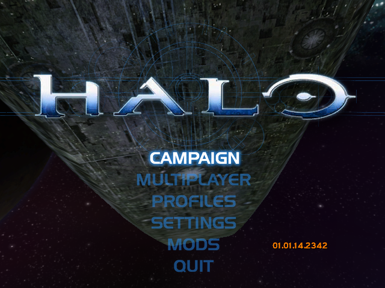
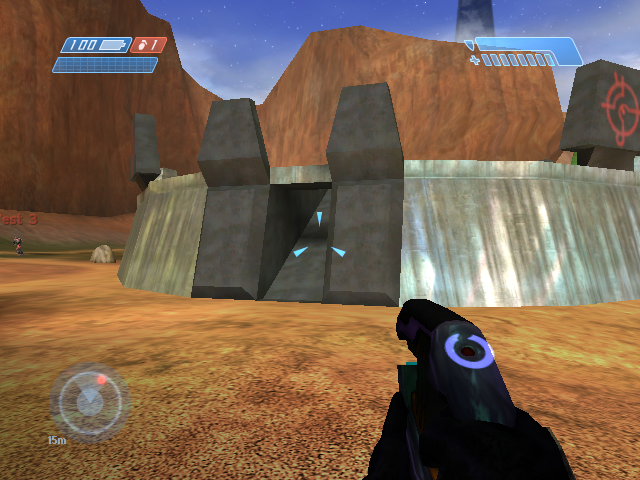
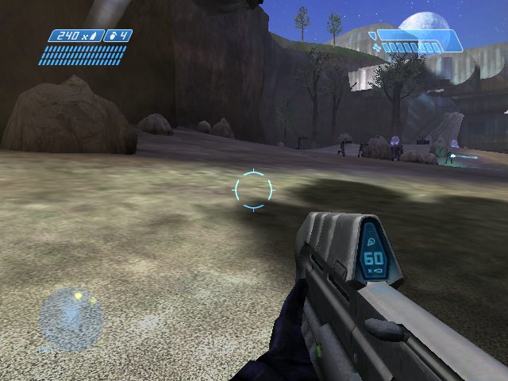

# OpenCE for the original Xbox

This is a fork of [OpenCE](https://github.com/OpenCommunityEdition/OpenCE),
the port of the Halo: Combat Evolved decompilation (Xbox build 2342) to
Linux, Windows, Android and the web. The fork adds one more platform: **the
original Xbox**, built from the same sources as the other ports with
[nxdk](https://github.com/XboxDev/nxdk).

The game's own code, OpenCE's netcode and its PC menus all compile for the
Xbox unchanged. A new platform layer (`port/xbox/src`) stands in for the
desktop's OpenGL, SDL and sockets: Direct3D 8 drawn on the NV2A through
pbkit, sound through the AC'97 controller, controllers through nxdk's USB
stack, and networking through lwIP. Because the netcode and its network
version are the same, an Xbox is meant to play with the PC builds over system
link and internet play (two Xboxes play together; an Xbox with a PC is still
to be tried).

The Xbox port lives on the
[`xbox-backport`](https://github.com/vsod99/halo-ce-universal/tree/xbox-backport)
branch, which is rebased onto OpenCE's `main` as upstream moves. Its full
documentation is
[`port/xbox/README.md`](https://github.com/vsod99/halo-ce-universal/blob/xbox-backport/port/xbox/README.md).
For the PC, Android and web builds, use [OpenCE](https://github.com/OpenCommunityEdition/OpenCE)
itself.

> **Work in progress.** Everything below runs in [xemu](https://xemu.app).
> It has not yet been tried on a real console.

## Screenshots

All three are frames the Xbox build saved from inside xemu (640×480).

  
  
  

<em>The PC menus, a Blood Gulch network game with another player's name over their head, and the campaign's second level (b30).</em>

## What works

- The PC menus, their pictures downscaled for the Xbox at build time, with
  the Xbox's own rows in the settings screens (widescreen, field of view).
- The campaign, multiplayer, split screen, and 480p or 480i at 4:3 or 16:9
  (anamorphic, following the dashboard's setting).
- Sound and music, mixed by OpenCE's mixer onto the AC'97 controller.
- System link and internet play, including joining games in progress, the
  server browser and UPnP. Two Xboxes play together in xemu.
- Most Halo Custom Edition maps. Large ones have their textures and model
  geometry loaded as they are needed.
- Starting from the Halo disc: with no `maps` folder beside the program,
  the maps are read from the disc in the drive, and the game asks for the
  disc if there is none.
- A self-updater from GitHub releases (it has no Xbox releases to install
  yet).

## Need to knows

- **A 128 MB console is required.** Every machine in an OpenCE game must
  share the same object and player capacity, which raises the game state to
  16 MB. That doesn't fit beside the map caches in a stock console's 64 MB.
- **The console must be modified to run homebrew.** The program is an
  unsigned XBE.
- **You need your own copy of Halo.** Nothing from the game is included:
  put the disc in the drive, or copy its `maps` folder beside the program.
- **It plays with the PC builds of the same network version.** OpenCE raises
  `HALO_PORT_NETWORK_VERSION` whenever the machines' messages change, and
  builds of different versions don't see each other's games. The Xbox
  branch follows upstream's `main`, so match it with a PC build of the same
  time.
- **Not on the Xbox:** the high-res HUD and text, mods, HDR, model detail
  settings, higher resolutions and Smooth Motion. The game runs at 30 fps
  at 480 lines, as the original did.
- **Settings and saves** are kept on the hard disk, in `E:\halo`.
- **Performance in xemu:** an Xbox hosts a 16-player game at 30 fps until
  everyone starts firing, at which point it drops to about 18 fps. As a
  client it runs a 17-player firefight at 12–17 fps and a 33-player one at
  5–7 fps. In large games it's limited by simulating every player, not by
  the network. A real console's numbers are still to be measured.

## Building

The build runs on macOS, Linux, or Windows through WSL. On macOS:

1. Install the tools:

       brew install llvm lld coreutils ninja
       brew install --cask xemu

2. Get nxdk and build its libraries optimized (its makefile builds them
   without optimization otherwise):

       git clone --recursive https://github.com/XboxDev/nxdk ~/source/repos/nxdk
       cd ~/source/repos/nxdk && NXDK_DIR=$PWD PATH=$PWD/bin:/opt/homebrew/opt/llvm/bin:$PATH \
         make -B CFLAGS=-O2 $(for l in libpdclib libwinapi libxboxrt libnxdk libnxdk_hal libpbkit \
           nxdk_usb libnxdk_automount_d xboxkrnl/libxboxkrnl; do echo $PWD/lib/$l.lib; done)

3. Check out the Xbox branch, and copy `port/xbox/xemu.example.toml` to
   `port/xbox/xemu.local.toml`. Fill in nxdk's path and, to run in xemu, the
   MCPX boot ROM dumped from your own console, a flash BIOS that gives the
   program 128 MB (Cerbios is what this is tested with), a hard disk image,
   and your Halo maps folder:

       git clone -b xbox-backport https://github.com/vsod99/halo-ce-universal
       cd halo-ce-universal
       python3 tools/xbox_dev.py doctor

4. Build:

       python3 configure.py --release
       ninja xbox

   The program is `build/xbox/halo/bin/default.xbe`.

5. Run it in xemu (the maps in `xemu.local.toml`'s `[game]` are packed
   beside it):

       python3 tools/xbox_dev.py run build/xbox/halo

Windows (WSL) setup, the test tools (two-Xbox system link, profiling,
screenshots) and the platform layer are described in
[`port/xbox/README.md`](https://github.com/vsod99/halo-ce-universal/blob/xbox-backport/port/xbox/README.md).

GitHub Actions also builds the Xbox on every push to `xbox-backport`. The
`halo-xbox-release` and `halo-xbox-debug` artifacts are on the branch's
[workflow runs](https://github.com/vsod99/halo-ce-universal/actions?query=branch%3Axbox-backport).

### On a console

Copy `default.xbe` and `brokers.txt` (internet play's brokers) to a folder
on the hard disk, for example by FTP to `E:\Apps\OpenCE`, and start it from
your dashboard. Put the Halo disc in the drive, or a `maps` folder beside
the XBE. For Custom Edition maps, add a `custom_maps` folder beside it, with
their `bitmaps.map`, `sounds.map` and `loc.map`.

## Credits

OpenCE and the decompilation it builds on: see
[OpenCE](https://github.com/OpenCommunityEdition/OpenCE), which started from
[bnunu/halo-1](https://github.com/bnunu/halo-1), a fork of
[punpckhdq/halo](https://github.com/punpckhdq/halo). The Xbox build uses
[nxdk](https://github.com/XboxDev/nxdk), lwIP and pbkit, and is tested in
[xemu](https://xemu.app).

The repository is CC0, as OpenCE's is. Halo is Microsoft's: this project
contains none of the game's data.
